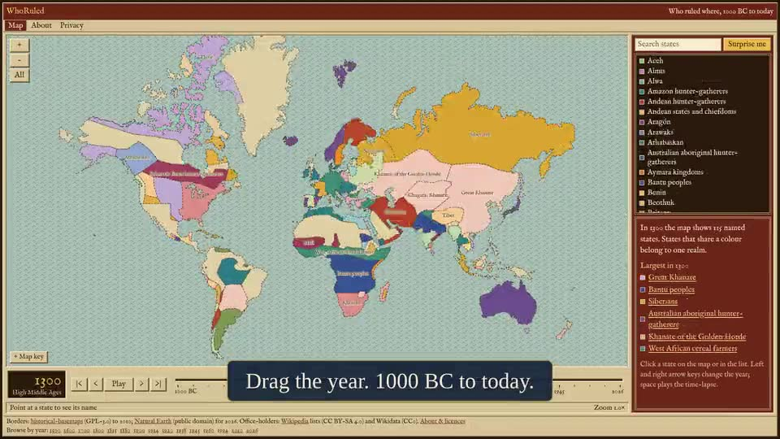

# WhoRuled

**An interactive world-history map: drag a year slider from 1000 BC to today and see who ruled where.**
Every ruler on the map links to a source.

Live site: https://whoruled.nitinsijwali.com

[](public/demo/whoruled-demo.mp4)

- Drag the slider to a year; borders and the look of the page change with the era (cave wall, manuscript, atlas, newspaper, modern).
- Click a state to see its rulers, government below the ruler, and events, each with a source link.
- Static pages for search: `/year/<year>/`, `/state/<qid>/` and `/state/<qid>/<year>/` ("Who ruled France in 1960?").
- No backend, no accounts, no cookies unless ads are switched on.

## Quick start

Requires Node 22+ (CI uses 24) and npm.

```bash
git clone https://github.com/nsijwali/WhoRuled.git
cd WhoRuled
npm ci
npm run dev        # http://localhost:4321
```

`dev` and `build` first rebuild the map geometry and validate all facts (`predev` / `prebuild`), so the first start takes a few seconds.

## Commands

| Command | What it does |
| --- | --- |
| `npm run dev` | Dev server with hot reload |
| `npm run build` | Production build into `dist/` (also validates all data) |
| `npm run preview` | Serve `dist/` locally |
| `npm run lint` | ESLint |
| `npm run typecheck` | `astro check` plus `tsc` on the pipeline |
| `npm test` | Vitest unit tests |
| `npm run e2e` | Playwright smoke test against `dist/` (needs `CHROMIUM_PATH`, see below) |
| `npm run import:leaders` | Turn the raw leader lists in `pipeline/import/` into fact files |

Before opening a pull request, run all of: `npm run lint && npm run typecheck && npm test && npm run build`.

For the smoke test, point `CHROMIUM_PATH` at a Chromium binary, for example `CHROMIUM_PATH="$(node -e "console.log(require('playwright-core').chromium.executablePath())")" npm run e2e` after `npx playwright-core install chromium`.

## How it works

```
data/borders-gpl/   historical border GeoJSON (GPL)        ─┐
data/borders-ne/    present-day borders, Natural Earth       ├─ pipeline/build-geo.ts ─► public/data/geo/*.topojson
data/facts/*.json   rulers, offices, events (CC0 / CC BY-SA) ─► pipeline/build-facts.ts ─► validated + indexed
                                                               │
                                          Astro (static pages) + one React island (Canvas 2D map)
                                                               │
                                          dist/  ─►  Cloudflare Workers static assets
```

- **Stack:** Astro 7, one React 19 island, Canvas 2D with d3-geo, TypeScript (strict), zod for validation, Vitest, Playwright.
- **Geometry** is simplified with mapshaper and quantised into TopoJSON, one file per snapshot year (the whole `public/data` folder is about 7 MB).
- **Facts** are one JSON file per state, named by its Wikidata QID. The schema (`src/data/schema.ts`) rejects any ruler, office or event without a source URL and quote, so unsourced claims cannot reach the site.
- **Pages are static.** Nothing runs on a server; the host just serves files.

## Project layout

| Path | Contents |
| --- | --- |
| `src/map/` | Canvas renderer, era themes, palette, geometry helpers |
| `src/components/` | `MapIsland.tsx` (the interactive map), ad and consent components |
| `src/pages/` | Home, About, Privacy, Support, year and state pages, sitemap, robots |
| `src/data/` | Fact schema and the helpers that build the year and state-year pages |
| `src/config/site.ts` | Site URL and the optional monetisation settings |
| `pipeline/` | Geometry build, facts build, leader importer, review guard |
| `data/` | Border geometry and facts (separate folders for separate licences) |
| `docs/` | Deploy, security, SEO, monetisation and review notes |
| `e2e/`, `tests/` | Smoke test and pipeline tests |

## Contributing

Corrections are the most useful contribution.

- **Spot a mistake?** Use the "Suggest a correction" link on any state or the map; it opens a pre-filled GitHub issue. Include a source.
- **Adding or fixing a fact:** edit `data/facts/<QID>.json`. Every ruler, office and event needs `source.url` and `source.quote`. The polity id is its Wikidata QID. Army sizes are only accepted with a citation and a confidence level.
- **Adding leaders for a year:** see the header of `pipeline/import-leaders.ts` for the raw-file format, then run `npm run import:leaders`.
- Keep changes focused, add or update tests for behaviour changes, and make sure the four checks above pass.
- Do not set a page's `review` field; only the owner records reviews (see `docs/REVIEW.md`).

## Configuration

The site works with no configuration. Optional features are switched on by build-time environment variables (set them in your host's build settings, not in the repo):

| Variable | Effect |
| --- | --- |
| `PUBLIC_SITE_URL` | Canonical address used in links, sitemap and share cards |
| `PUBLIC_PAYPAL_ME`, `PUBLIC_UPI_ID` | Tip options on `/support/` (the UPI QR is generated at build time) |
| `PUBLIC_AMAZON_TAG` | Amazon Associates tag for "books about..." links |
| `PUBLIC_ADS_CLIENT` | Google AdSense publisher id (ads and consent banner off when empty) |
| `PUBLIC_CF_ANALYTICS_TOKEN` | Cloudflare Web Analytics |

Details: `docs/MONETIZATION.md`. Security headers and the content security policy: `docs/SECURITY.md`. SEO: `docs/SEO.md`.

## Deployment

Hosted on Cloudflare Workers static assets; merging to `main` publishes. See `docs/DEPLOY.md`.

## Known limitations

- Leader data is thin before 1600, and some small states have none yet.
- Borders before about 500 BC are approximate and drawn dashed.
- Present-day borders follow Natural Earth's de facto point of view.

## Licence and data credits

Code is MIT (`LICENSE`). The data has its own licences: facts are CC0 or CC BY-SA (imported Wikipedia lists), historical borders come from [historical-basemaps](https://github.com/aourednik/historical-basemaps) under the GPL, and present-day borders are [Natural Earth](https://www.naturalearthdata.com) (public domain). See `LICENSING.md` for the details and what you must keep when reusing each part.
