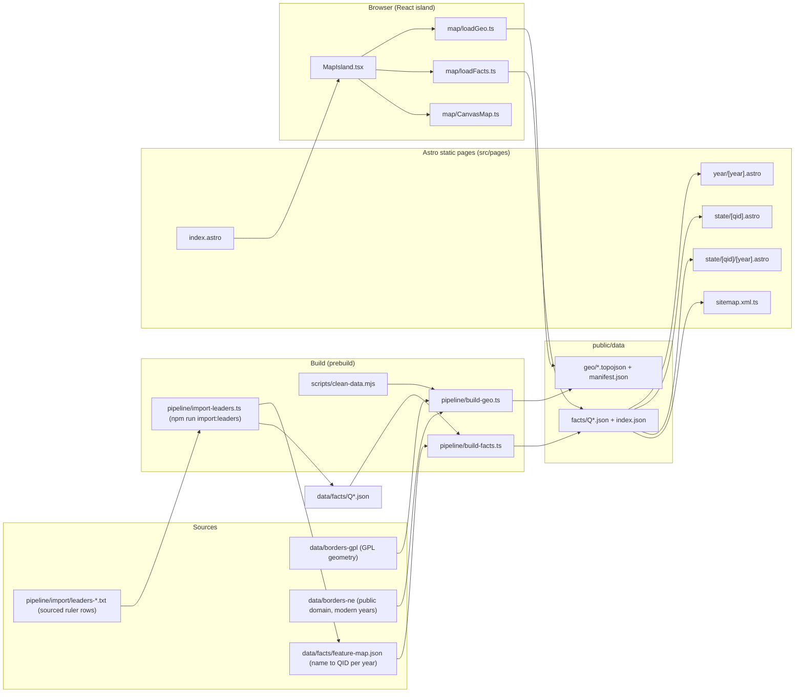

# Architecture

WhoRuled is a static site. Data is prepared at build time, and the browser only fetches prebuilt JSON and TopoJSON files.

## Notes

- **Geometry and facts are separate.** Border geometry is GPL and lives in `data/borders-*`. Facts are CC0 and live in `data/facts/`. Each polity is identified by its Wikidata QID.
- **Only the map island runs in the browser.** Everything else is rendered to static HTML at build time.
- **Static pages read facts at build time.** `src/data/browseYears.ts` and `src/data/stateYears.ts` read the facts through `pipeline/build-facts.ts`. The sitemap includes only pages that pass `isIndexable`.
- **Build-time configuration** comes from `PUBLIC_*` environment variables, read in `src/config/site.ts`.
- **CI** (`.github/workflows/ci.yml`) runs lint, typecheck, tests, build, and a browser smoke test. `review-guard.yml` runs `pipeline/review-guard.ts`.
